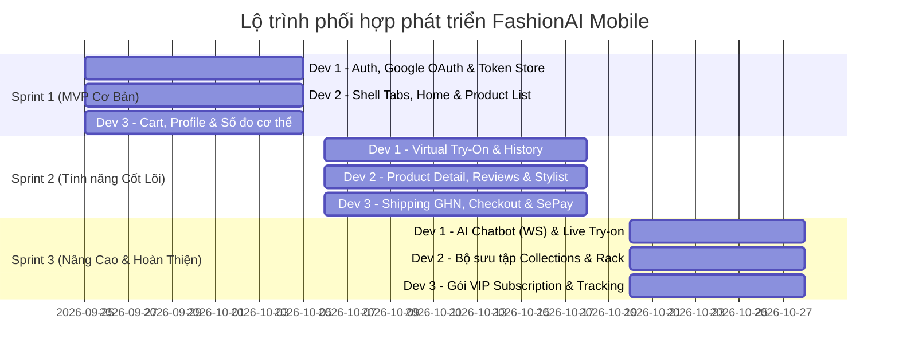

# Kế Hoạch Phân Chia Công Việc Phát Triển Mobile App (3 Developers) — FashionAI

> **Cập nhật ngày:** 2026-09-24  
> **Tình trạng Backend:** Backend NestJS tại `D:\EXE_Project\fashionai-backend` **đã hoàn thiện 100%** (bao gồm toàn bộ API endpoints, WebSocket gateways, Collections, Live Try-on, Shipping GHN, SePay, và Reviews).  
> **Tham chiếu Web Frontend:** `D:\EXE_Project\fashionai-frontend` (các thư mục `src/features/*`).  
> **Quy ước bắt buộc từ BE:** Header `X-Platform: mobile`, Bearer Token, OAuth redirect deep link `fashionai://auth`.

---

## 1. Kiến trúc phân chia trách nhiệm (3 Developers)

```
┌────────────────────────────────────────────────────────────────────────┐
│                        FASHIONAI MOBILE TEAM                           │
├───────────────────────┬────────────────────────┬───────────────────────┤
│   DEV 1: CORE & AI    │ DEV 2: SHOP & STYLIST  │ DEV 3: COMMERCE & SUB │
├───────────────────────┼────────────────────────┼───────────────────────┤
│ • Auth & Security     │ • Navigation Shell     │ • Giỏ hàng (Cart)     │
│ • Virtual Try-On      │ • Trang chủ & Banner   │ • Phí ship GHN        │
│ • Live Try-On Video   │ • Bộ sưu tập (Collec)  │ • Checkout & Đặt hàng │
│ • AI Chatbot (WS)     │ • Danh mục sản phẩm    │ • Thanh toán SePay    │
│ • Realtime Gateway &  │ • Chi tiết & Reviews   │ • Quản lý đơn hàng    │
│   Notifications       │ • AI Stylist & Tủ đồ   │ • Gói VIP & Số đo     │
└───────────────────────┴────────────────────────┴───────────────────────┘
```

---

## 2. Chi tiết phân công công việc theo Backend Controller thực tế

---

### 👤 DEV 1: Auth, Trải nghiệm AI & Realtime (AI & Platform Lead)

**Trọng tâm:** Làm chủ hệ thống xác thực an toàn, toàn bộ tính năng AI (Virtual Try-On, Live Try-On, AI Chatbot) và kênh Realtime Socket.

#### A. Modules & Endpoints Backend phụ trách:
1. **Xác thực & Bảo mật (`auth.controller.ts` — 14 endpoints):**
   - `GET /auth/google?platform=mobile` & Deep link `fashionai://auth`: Mở qua In-App Browser (`expo-web-browser`).
   - `POST /auth/exchange`: Đổi auth code lấy bộ token (kèm header `X-Platform: mobile`).
   - `POST /auth/register`: Đăng ký tài khoản (`email`, `password`, `name`).
   - `POST /auth/login`: Đăng nhập lấy access/refresh token.
   - `POST /auth/refresh`: Tự động rotate refresh token qua Axios interceptor.
   - `POST /auth/logout` & `POST /auth/logout-all`: Đăng xuất và xóa token khỏi `expo-secure-store`.
   - `POST /auth/forgot-password`, `POST /auth/reset-password`: Quên và đặt lại mật khẩu.
   - `POST /auth/change-password`: Đổi mật khẩu trong cài đặt.
   - `POST /auth/verify-email`, `POST /auth/resend-verification`: Xác thực email.
2. **AI Virtual Try-On (`try-on.controller.ts` — 6 endpoints):**
   - `POST /try-on`: Upload `multipart/form-data` gồm `humanImage` (ảnh người thật từ camera/thư viện qua `expo-image-picker`) và danh sách `garments[i][image]`, `garments[i][category]` (`UPPER` | `LOWER` | `FULL_BODY`).
   - `GET /try-on/history`: Lấy lịch sử các lần thử đồ (hỗ trợ phân trang).
   - `GET /try-on/history/:id`: Chi tiết lần thử đồ, xem ảnh gốc và ảnh kết quả AI.
   - `GET /try-on/history/:id/download`: Tải ảnh kết quả về máy (`expo-file-system`/`expo-media-library`).
   - `DELETE /try-on/history/:id` & `DELETE /try-on/history/all`: Xóa lịch sử.
3. **Live Try-On Realtime (`live-try-on.controller.ts` — 7 endpoints):**
   - `GET /try-on/live/quota`: Kiểm tra hạn mức phiên Live Try-on còn lại.
   - `GET /try-on/live/garments/:productId`: Kiểm tra sản phẩm có hỗ trợ chế độ Live không.
   - `POST /try-on/live/sessions`: Khởi tạo phiên thử đồ trực tiếp qua camera.
   - `GET /try-on/live/sessions/:id`: Lấy trạng thái phiên.
   - `POST /try-on/live/sessions/:id/pause` & `/resume` & `/end`: Điều khiển phiên.
4. **AI Chatbot (`chat.controller.ts` + `chat.gateway.ts`):**
   - Kết nối WebSocket namespace `/chat` (chỉ dùng transport `websocket`, kèm Bearer token).
   - Sự kiện gửi: `chat:send` `{ message, sessionId }`.
   - Sự kiện nhận: `chat:token` (stream từng chữ mượt mà), `chat:done` (kết thúc), `chat:error` (báo lỗi quota/hệ thống).
   - `GET /chat/sessions`: Danh sách các cuộc trò chuyện trước đây.
   - `GET /chat/sessions/:sessionId`: Lịch sử tin nhắn theo phiên.
   - `DELETE /chat/sessions/:sessionId`: Xóa phiên chat.
5. **Thông báo Realtime (`notification.controller.ts` + `realtime.gateway.ts`):**
   - Lắng nghe event `token:expiring` từ `realtime.gateway.ts` để tự động refresh token trong socket.
   - `GET /notifications`: Danh sách thông báo.
   - `GET /notifications/unread-count`: Số thông báo chưa đọc (hiển thị chấm đỏ trên chuông).
   - `PATCH /notifications/:id/read` & `PATCH /notifications/read-all`: Đánh dấu đã đọc.

#### B. Nguồn tham chiếu từ Web (`fashionai-frontend`):
- `src/features/auth/*`
- `src/features/try-on/*`
- `src/features/chat/*`
- `src/features/notifications/*`

#### C. Checklist công việc Dev 1:
- [x] Dựng bộ màn hình Auth: Login, Register, Forgot Password, Reset Password, VerifyEmail OTP 4 số + ChangePassword (kèm xử lý 403 chưa verify, SecureStore, interceptor auto-refresh `ACCESS_TOKEN_EXPIRED`).
- [x] Tích hợp Google OAuth In-App Browser + deep link callback `fashionai://auth`.
- [x] Dựng màn Try-On Workspace: Chọn ảnh từ thư viện/camera, chọn loại áo/quần/váy, upload multipart.
- [x] Dựng màn Try-On History + Trình xem ảnh so sánh kết quả + Tải ảnh kết quả về máy (`GET /try-on/history/:id/download`) + Xóa 1 mục / Xóa tất cả.
- [x] Tích hợp Live Try-On Workspace (Camera view + điều khiển phiên session).
  > ⚠️ **Chưa hoàn chỉnh — giới hạn camera đã xác nhận:** màn hình, vòng đời session
  > (create/pause/resume/end), quota giây và preview camera trước chạy thật; nhưng **camera
  > chỉ hiện preview thường, KHÔNG bật/render video AI ghép đồ trực tiếp** (Decart stream
  > như bản web) vì chưa tích hợp Decart SDK cho React Native — vượt ngoài 7 endpoints
  > hiện tại của `live-try-on.controller.ts`. Khi nghiệm thu phải nói rõ điểm này.
- [ ] Dựng màn Chatbot AI: Giao diện tin nhắn, kết nối WebSocket `/chat`, stream text, hiển thị gợi ý đồ.
  > ❌ **Chưa làm — thiếu toàn bộ `src/features/chat/`:** chưa có `chat.api.ts` (`GET /chat/sessions`, `GET /chat/sessions/:sessionId`, `DELETE /chat/sessions/:sessionId`), types, hooks, `ChatScreen`, route navigation, handler `chat:send` / `chat:token` / `chat:done` / `chat:error`. Hạ tầng duy nhất đã có là `ENDPOINTS.CHAT` + `getChatSocket()` trong `src/realtime/socket.ts` (chưa được gọi ở đâu).
- [x] Dựng màn Notification List & Badge chuông thông báo — đã xong (`NotificationsScreen`, `NotificationBell` trong header `MainTabs`, `use-notifications` + `use-notification-socket`, route `Notifications`).
  > ℹ️ **Thiếu sót nhỏ đã xác nhận (không chặn nghiệm thu):**
  > - ✅ Đã xong `ENDPOINTS.TRY_ON.DOWNLOAD(id)` — `tryOnApi.downloadResult()` dùng constant thay vì nối chuỗi thủ công.
  > - `tryOnApi.getHistory()` trả mảng thô, chưa dùng `http.getPaged` như `notificationsApi` nên mất `meta.totalPages`; `use-try-on-history.ts` phải đoán `hasNextPage` bằng `length === limit`.
  > - `ENDPOINTS.CHAT` thiếu endpoint `DELETE /chat/sessions/:sessionId` theo allocation; `RootStackParamList` chưa có route `Chat*` nào.

---

### 👤 DEV 2: Khám phá sản phẩm, Bộ sưu tập & AI Stylist (Catalog & Styling Lead)

**Trọng tâm:** Xây dựng Navigation Shell, trang chủ, bộ sưu tập thời trang, danh mục sản phẩm kèm đánh giá reviews, AI Stylist và tủ đồ cá nhân (Rack).

#### A. Modules & Endpoints Backend phụ trách:
1. **Khung điều hướng & Trang chủ (Navigation Shell & Home):**
   - Setup Bottom Tab Navigator chuẩn (Home, Try-On, Collections/Shop, Stylist, Profile).
   - Trang Home: Header chào mừng, Quota Badge (`GET /users/me/quota`), Hero Banner, Danh mục gợi ý.
2. **Bộ sưu tập thời trang (`collections.controller.ts` — 10 endpoints):**
   - `GET /collections/published`: Danh sách các Lookbook / Bộ sưu tập đang phát hành (Hiển thị carousel banner trang chủ).
   - `GET /collections/:slug`: Chi tiết bộ sưu tập (hình ảnh concept, mô tả xu hướng).
   - `GET /collections/:collectionId/products`: Danh sách sản phẩm thuộc bộ sưu tập.
3. **Danh mục sản phẩm (`products.controller.ts` — 8 endpoints):**
   - `GET /products`: Danh sách sản phẩm hỗ trợ tìm kiếm (`search`), lọc danh mục (`category`), loại trang phục (`garmentType`), màu, chất liệu, khoảng giá (`minPrice`, `maxPrice`), trạng thái, sắp xếp và phân trang (`page`, `limit`).
   - `GET /products/:id`: Chi tiết sản phẩm may đo, màu sắc và số lượng tồn kho.
   - `GET /products/:id/reviews/stats`: Tổng điểm đánh giá sao và số lượt review.
4. **Hệ thống đánh giá sản phẩm (`reviews.controller.ts` — 11 endpoints):**
   - `GET /products/:productId/reviews`: Danh sách đánh giá của sản phẩm (hỗ trợ lọc theo số sao, có kèm ảnh).
   - `GET /products/:productId/reviews/stats`: Phân bố số sao (1★ đến 5★).
   - `POST /products/:productId/reviews`: Viết đánh giá mới (gửi số sao, nội dung nhận xét, đính kèm ảnh chụp).
   - `GET /products/reviews/my`: Danh sách đánh giá mà chính người dùng đã viết.
   - `PATCH /products/reviews/:id` & `DELETE /products/reviews/:id`: Sửa/Xóa đánh giá của mình.
   - `GET /products/reviews/:reviewId/replies`: Xem phản hồi từ phía shop.
5. **AI Stylist tư vấn phối đồ (`stylist.controller.ts` — 4 endpoints):**
   - `POST /stylist/analyze`: Gửi yêu cầu tư vấn phối đồ (nhập dịp: đi làm, tiệc, dạo phố, phong cách: tối giản, cổ điển, streetwear, ngân sách...). Nhận lại gợi ý phối set đồ từ AI.
   - `GET /stylist/history`: Lịch sử các lần tư vấn.
   - `GET /stylist/history/:id`: Xem chi tiết set đồ được gợi ý.
   - `DELETE /stylist/history/:id`: Xóa lịch sử tư vấn.
6. **Tủ đồ cá nhân ảo (`rack.controller.ts` — 4 endpoints):**
   - `GET /rack`: Lấy danh sách toàn bộ các món đồ đã lưu vào tủ đồ cá nhân.
   - `POST /rack`: Lưu một sản phẩm vào tủ đồ.
   - `DELETE /rack/:id`: Bỏ một món đồ khỏi tủ đồ.
   - `DELETE /rack/all`: Xóa toàn bộ tủ đồ.

#### B. Nguồn tham chiếu từ Web (`fashionai-frontend`):
- `src/features/home/*`
- `src/features/collections/*`
- `src/features/products/*`
- `src/features/reviews/*`
- `src/features/stylist/*`
- `src/features/rack/*`

#### C. Checklist công việc Dev 2:
- [ ] Dựng khung Navigation Bottom Tabs hoàn chỉnh với icon và theme nhất quán.
- [ ] Dựng màn hình Home: Tích hợp Quota Card, Collection Hero Banner, Hot Deals.
- [ ] Dựng màn hình Bộ sưu tập (Collections): Danh sách Lookbook & danh sách sản phẩm theo collection.
- [ ] Dựng màn hình Danh mục sản phẩm (Product List): Grid 2 cột, Infinite Scroll, Thanh tìm kiếm debounce.
- [ ] Dựng Modal Bộ lọc sản phẩm (Filter Modal: Danh mục, loại trang phục, khoảng giá, màu, chất liệu).
- [ ] Dựng màn hình Chi tiết sản phẩm: Image Carousel (`expo-image`), chọn màu, nút "Thử đồ", nút "Thêm vào giỏ".
- [ ] Dựng Tab Reviews: Thống kê rating, danh sách review, Modal viết đánh giá với danh sách URL ảnh theo contract hiện tại.
- [ ] Dựng màn hình AI Stylist: Form tư vấn theo ngữ cảnh + Hiển thị Card set đồ phối sẵn.
- [ ] Dựng màn hình Tủ đồ cá nhân (Rack) + Nút chuyển đồ nhanh sang màn hình Try-On của Dev 1.

---

### 👤 DEV 3: Thương mại điện tử, Thanh toán & Hội viên (Commerce & Account Lead)

**Trọng tâm:** Xây dựng toàn bộ luồng mua sắm giao dịch (Giỏ hàng -> Phí ship GHN -> Đặt hàng -> Cổng thanh toán SePay -> Quản lý đơn) và Hồ sơ cá nhân / Số đo cơ thể / Gói VIP.

#### A. Modules & Endpoints Backend phụ trách:
1. **Địa chỉ & Vận chuyển GHN (`shipping.controller.ts` — 5 endpoints):**
   - `GET /shipping/provinces`: Danh sách Tỉnh/Thành phố.
   - `GET /shipping/districts?provinceId=...`: Danh sách Quận/Huyện.
   - `GET /shipping/wards?districtId=...`: Danh sách Phường/Xã.
   - `GET /shipping/locations`: Cây địa giới hành chính.
   - `POST /shipping/calculate-fee`: Tính toán phí vận chuyển thực tế từ dịch vụ GHN dựa trên địa chỉ nhận hàng và trọng lượng.
2. **Giỏ hàng & Đơn hàng (`orders.controller.ts` — 14 endpoints):**
   - Quản lý giỏ hàng phía Client bằng Zustand (lưu Local Storage/AsyncStorage, lưu productId/color/quantity).
   - `POST /orders/quote`: Preview đơn hàng trước khi chốt: tính tổng tiền sản phẩm, tiền ship, áp mã giảm giá để hiển thị cho khách kiểm tra.
   - `POST /orders`: Tạo đơn hàng chính thức.
   - `GET /orders`: Danh sách đơn hàng của tôi (lọc theo tab: Chờ thanh toán, Đang xử lý, Đang giao, Đã giao, Đã hủy).
   - `GET /orders/:id`: Chi tiết đơn hàng, danh sách sản phẩm đã mua, địa chỉ nhận hàng.
   - `GET /orders/:id/tracking`: Xem trạng thái hành trình vận chuyển thực tế từ hãng vận chuyển.
   - `PATCH /orders/:id/cancel`: Hủy đơn hàng khi chưa chuyển cho vận chuyển.
   - `POST /orders/:id/confirm-delivery`: Khách hàng xác nhận đã nhận được hàng.
   - `PATCH /orders/:orderId/items/:itemId/measurement`: Gắn thông tin số đo vào đơn hàng may đo/custom.
3. **Thanh toán SePay (`payments.controller.ts` — 13 endpoints):**
   - `POST /payments/checkout`: Tạo yêu cầu thanh toán qua cổng SePay, nhận URL thanh toán / mã QR thanh toán ngân hàng.
   - Mở giao diện thanh toán bằng In-App Browser (`expo-web-browser`) hoặc WebView.
   - `GET /payments/orders`: Lịch sử các giao dịch thanh toán.
4. **Gói thành viên & Quota AI (`payments.controller.ts` + `users.controller.ts`):**
   - `GET /payments/plans`: Bảng danh sách các gói dịch vụ (FREE, MEMBER, VIP) kèm quyền lợi và giá tiền.
   - `GET /payments/subscriptions/me`: Thông tin gói hội viên hiện tại, thời hạn hết hạn.
   - `GET /payments/subscriptions/history`: Lịch sử đăng ký/gia hạn gói.
   - `POST /payments/subscriptions/cancel` & `POST /payments/subscriptions/resume`: Quản lý tự động gia hạn.
   - Gọi luồng thanh toán SePay để nâng cấp lên MEMBER / VIP nhằm tăng hạn mức Try-On và Stylist.
5. **Hồ sơ cá nhân & Số đo cơ thể (`users.controller.ts` — 8 endpoints):**
   - `GET /users/me`: Lấy thông tin cá nhân hiện tại (email, tên, avatar, gói cước).
   - `PUT /users/me`: Cập nhật thông tin cá nhân.
   - `GET /users/me/measurements`: Lấy số đo cơ thể đã lưu.
   - `GET /users/me/measurements/completeness`: Độ hoàn thiện hồ sơ số đo (%).
   - `PUT /users/me/measurements`: Cập nhật số đo (chiều cao, cân nặng, vòng ngực, vòng eo, vòng mông) — phục vụ quy trình may đo và mô hình 3D.
   - `GET /users/me/quota`: Lấy thông tin chi tiết hạn mức AI hôm nay (`TRY_ON`, `STYLIST`, `CHATBOT`).

#### B. Nguồn tham chiếu từ Web (`fashionai-frontend`):
- `src/features/cart/*`
- `src/features/checkout/*`
- `src/features/shipping/*`
- `src/features/orders/*`
- `src/features/payments/*`
- `src/features/subscription/*`
- `src/features/profile/*`
- `src/features/measurements/*`

#### C. Checklist công việc Dev 3:
- [x] Xây dựng Zustand Store quản lý Giỏ hàng (Cart) hỗ trợ thêm, bớt, đổi số lượng, chọn biến thể.
- [x] Dựng màn hình Giỏ hàng (CartScreen).
- [x] Dựng màn hình Checkout: Bộ chọn Tỉnh/Thành -> Quận/Huyện -> Phường/Xã từ API `/shipping`, tính phí ship tự động, gọi `/orders/quote`.
- [x] Tích hợp mở cổng thanh toán SePay và xử lý callback quay về app để xác nhận đơn.
- [x] Dựng màn hình Danh sách đơn hàng (OrdersScreen) có các tab trạng thái.
- [x] Dựng màn hình Chi tiết đơn hàng & Timeline tracking vận chuyển.
- [x] Dựng màn hình Bảng giá Gói thành viên (SubscriptionScreen) + Luồng nâng cấp gói qua SePay.
- [x] Dựng màn hình Hồ sơ cá nhân (ProfileScreen) và Form nhập Số đo cơ thể (MeasurementsScreen).

---

## 3. Lộ trình phát triển 3 Sprint (5 Tuần)



### 🔹 Sprint 1: Dựng khung & Luồng Core MVP (Tuần 1 - 2)
- **Dev 1**: Màn Login, Register, Forgot Password + Google OAuth deep link + Quản lý token an toàn qua SecureStore.
- **Dev 2**: Cấu hình Root Bottom Tabs + Màn Home (kèm Quota Card) + Danh mục sản phẩm dạng Grid (Product List).
- **Dev 3**: Màn Profile cá nhân + Form nhập Số đo cơ thể (Measurements) + Quản lý Zustand Cart & Màn Giỏ hàng.
> 🎯 **Mục tiêu nghiệm thu Sprint 1**: Người dùng mở app -> Đăng nhập bằng Email hoặc Google -> Xem danh mục sản phẩm -> Thêm đồ vào giỏ -> Cập nhật số đo cá nhân.

### 🔹 Sprint 2: AI & Giao dịch cốt lõi (Tuần 3 - 4)
- **Dev 1**: Luồng Virtual Try-On (chọn ảnh người + ảnh đồ, gọi `POST /try-on`, màn History xem kết quả).
- **Dev 2**: Màn Chi tiết sản phẩm (Product Detail Carousel, chọn màu) + Đánh giá Reviews + Màn AI Stylist tư vấn phối đồ.
- **Dev 3**: Checkout đặt hàng (chọn địa chỉ Tỉnh/Huyện/Xã, tính phí ship GHN) + Tích hợp mở cổng thanh toán SePay + Lịch sử đơn hàng.
> 🎯 **Mục tiêu nghiệm thu Sprint 2**: Thực hiện thử đồ AI thật trên điện thoại và hoàn tất 1 đơn hàng test thanh toán qua SePay.

### 🔹 Sprint 3: Tính năng nâng cao, Realtime & Tối ưu (Tuần 5)
- **Dev 1**: AI Chatbot streaming qua WebSocket `/chat` + Live Try-On Video session + Trung tâm thông báo.
- **Dev 2**: Bộ sưu tập thời trang (Collections) + Quản lý Tủ đồ cá nhân (Rack) + Đánh giá hỗ trợ URL ảnh theo contract backend.
- **Dev 3**: Mua/nâng cấp Gói VIP Subscription để mở rộng quota AI + Màn hình Tracking đơn hàng chi tiết.
> 🎯 **Mục tiêu nghiệm thu Sprint 3**: Toàn bộ luồng app hoàn thiện, không lỗi TypeScript (`npx tsc --noEmit`), chạy mượt trên cả thiết bị iOS & Android thật.

---

## 4. Hợp đồng giao tiếp kỹ thuật giữa 3 Dev

### 4.1 Quy ước Navigation Params
Tất cả các route được khai báo tập trung tại [src/navigation/types.ts](file:///d:/EXE_Project/fashionai-mobile/src/navigation/types.ts):
```typescript
// 1. Chuyển sản phẩm từ màn Detail (Dev 2) sang Try-On (Dev 1)
navigation.navigate('TryOnTab', {
  productId: product.id,
  garmentImage: product.images[0].url,
  category: 'UPPER' // hoặc LOWER, FULL_BODY
});

// 2. Thêm đồ từ Product Detail (Dev 2) sang Giỏ hàng (Dev 3)
useCartStore.getState().addItem({
  productId: product.id,
  color: selectedColor,
  quantity: 1,
  price: product.price,
  title: product.name,
  image: product.images[0].url,
});

// 3. Chuyển từ Quota Badge (Dev 2) hoặc thông báo hết lượt (Dev 1) sang Mua gói VIP (Dev 3)
navigation.navigate('SubscriptionPlans');
```

### 4.2 Cấu trúc API Services theo feature
`src/api/` chỉ chứa HTTP client/interceptor dùng chung. Mỗi business API thuộc feature tương ứng dưới `src/features/<feature>/api/`:
- **Dev 1**:
  - `src/features/auth/api/auth.api.ts`
  - `src/features/try-on/api/try-on.api.ts`
  - `src/features/try-on/api/live-try-on.api.ts`
  - `src/features/chat/api/chat.api.ts`
  - `src/features/notifications/api/notifications.api.ts`
- **Dev 2**:
  - `src/features/collections/api/collections.api.ts`
  - `src/features/products/api/products.api.ts`
  - `src/features/reviews/api/reviews.api.ts`
  - `src/features/stylist/api/stylist.api.ts`
  - `src/features/rack/api/rack.api.ts`
- **Dev 3**:
  - `src/features/shipping/api/shipping.api.ts`
  - `src/features/orders/api/orders.api.ts`
  - `src/features/payments/api/payments.api.ts`
  - `src/features/subscription/api/subscriptions.api.ts`
  - `src/features/profile/api/users.api.ts`

### 4.3 Quy tắc Git & Tiêu chuẩn mã nguồn
- Nhánh chính: `main` (Production), `develop` (Integration).
- Tên nhánh tính năng: `feat/dev1-*`, `feat/dev2-*`, `feat/dev3-*`.
- **Quy tắc bắt buộc trước khi tạo Pull Request:**
  ```bash
  npx tsc --noEmit     # Phải đạt 0 lỗi TypeScript
  ```
